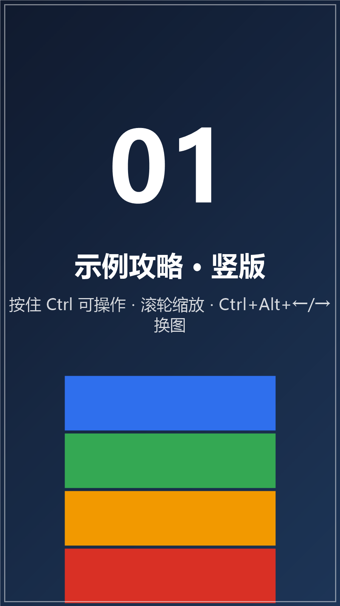

# GuideOverlay

Pin a walkthrough map or reference image **on top of your game**: the overlay is click-through by default, and you hold a gate key when you want to interact with it.

[中文](README.md) · [Player guide (Chinese)](使用说明.md)



## Features

- **Single-file C# 5 + WinForms**: the whole app is one `Program.cs`, no third-party dependencies, built with the .NET Framework compiler that ships with Windows (`build.bat`; no Visual Studio / SDK / NuGet required).
- **Click-through by default**: implemented with `WS_EX_TRANSPARENT | WS_EX_NOACTIVATE`, so clicks, wheel and drags go to the game underneath and the overlay never steals focus.
- **Gate-key interaction**: hold the gate key (default `Alt`, switchable to `Ctrl`/`Shift` in Settings) to drag, zoom, flip pages or resize the window; release and it becomes click-through again. `Ctrl+Alt+T` toggles locked interaction.
- **Image library**: cycles through a folder of images, auto-refresh keeps your reading position and zoom, natural sort, and a tall-image mode with automatic slicing/scrolling.
- **Full settings panel**: six sections (Window / Display / Zoom / Hotkeys / Images / Diagnostics); all 18 hotkeys can be rebound or disabled.
- **Context menu + top toolbar**: paging, fit-to-window, image lock, zoom, rotate/flip, tall-image mode, settings, hide.
- **No risky behaviour**: no process injection, no hooks, no input simulation, no network access.
- **Built-in self-test**: `GuideOverlay.exe --selftest` runs 577 assertions and writes 4 screenshots; exit code 0/1.

## Requirements

- Windows 7 SP1 or later (tested on Windows 10 / 11)
- .NET Framework 4.x (Windows 10/11 ship 4.8)
- No administrator rights, no internet connection

## Quick start

1. Clone or download this repository — a prebuilt `GuideOverlay.exe` is included; you can also build from source (see below).
2. Put the folder anywhere on disk (**do not** run the exe directly from inside an archive; see Known limitations).
3. Double-click `GuideOverlay.exe`; the window appears at the side of the screen.
4. Hold `Alt` to drag / zoom / flip pages; release the mouse and the overlay is click-through again.
5. The first run shows a ~20 second guided hint bar; it ends early when you press the gate key.

## Default hotkeys (excerpt)

| Action | Default hotkey |
| --- | --- |
| Gate key (hold to interact) | `Alt` (or `Ctrl` / `Shift`) |
| Lock / unlock interaction | `Ctrl+Alt+T` |
| Hide / show overlay | `Ctrl+Alt+G` |
| Previous / next image | `Ctrl+Alt+←` / `Ctrl+Alt+→` |
| Zoom (anchored at cursor) | hold gate key + mouse wheel |
| Pan image | hold gate key + left-drag |
| Fit to window | hold gate key + double-click |
| Open settings | hold gate key + toolbar "设置…" |

The full hotkey list is in the Chinese [player guide](使用说明.md).

## Build from source

You need the `csc.exe` shipped with Windows (`%WINDIR%\Microsoft.NET\Framework64\v4.0.30319\`, falling back to `Framework` on 32-bit systems).

```bat
build.bat            :: produces GuideOverlay.exe (never deletes the old exe on failure)
GuideOverlay.exe --selftest
```

> `build.bat` is GBK(936)-encoded (it prints Chinese messages); re-saving it as UTF-8 garbles those messages.

`build.bat` compiles into `obj\GuideOverlay.exe` and only replaces the executable in the project root on success; compile errors, a locked exe or a missing `csc` all print a Chinese message and keep the previous exe.

## Layout

```
GuideOverlay/
├─ Program.cs              single source file (~16.7k lines)
├─ build.bat               build script (Windows built-in csc)
├─ selftest.bat            self-test entry
├─ 使用说明.md              detailed player guide (Chinese)
├─ README.md               Chinese README
├─ README.en.md            this file
├─ images/                 sample images (replace with your own)
└─ LICENSE
```

## Privacy and permissions

- No network access, no telemetry, no registry writes, no background service.
- Settings live only in `settings.ini` next to the executable (created on first run; `settings.ini.bak` is the previous copy).
- Your image folder is scanned read-only; images are never modified or deleted.
- The executable is **not code-signed**, so SmartScreen or antivirus software may warn on first launch; see the [player guide](使用说明.md).

## Known limitations

- Launching the exe directly from inside an archive (low-integrity host, e.g. a chat app) blocks keyboard access, so the gate key will not work; extract first and launch from Explorer.
- The `--selftest` PNGs can verify painting but not window transparency (screenshots 3 and 4 are intentionally identical).
- Windows only.

## License

[MIT](LICENSE)
